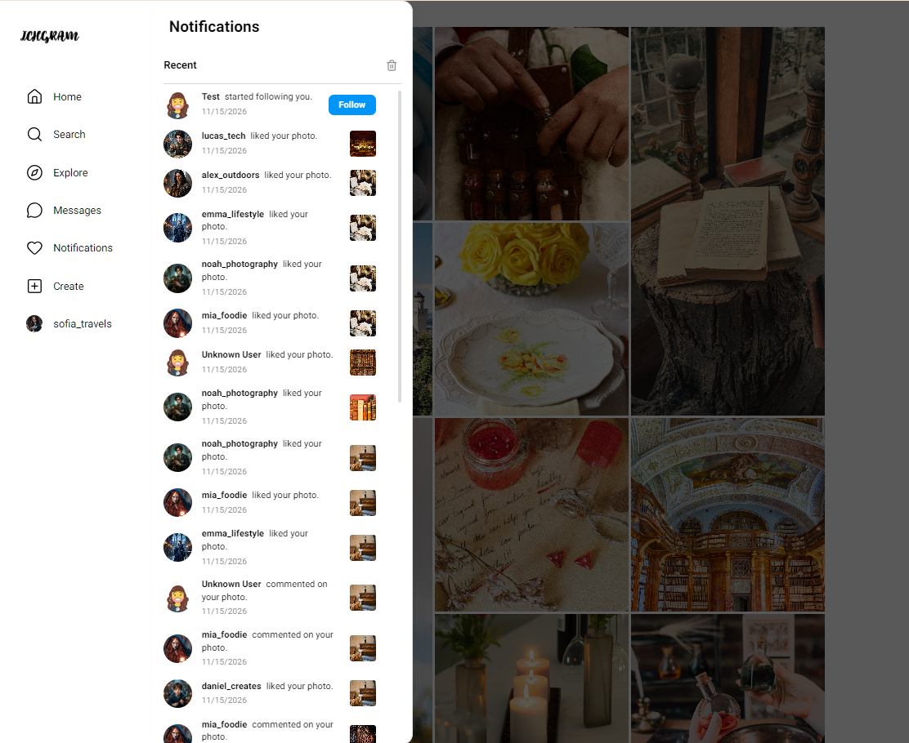
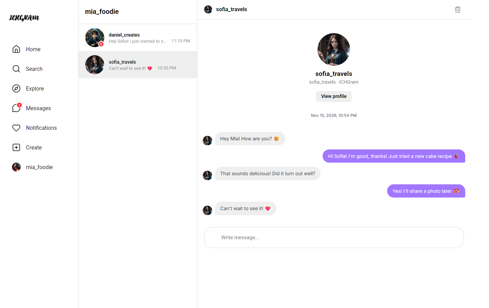

# ICHGram — Full-Stack Social Network

A mini Instagram-like social network built as the final project of the Node.js course at IT Career Hub.

ICHGram allows users to create accounts, share photo posts, interact with other users, follow profiles, receive notifications and communicate through real-time chat.


## Features

- **Authentication:** User registration and login with JWT, password hashing with bcrypt, password reset via email using a one-time link valid for 15 minutes.
- **User Profiles:** Profile pictures, bio, website, profile editing and password changes.
- **Posts:** Create, edit and delete photo posts. Image uploads handled with Multer.
- **Interactions:** Like and comment on posts, including likes on comments. Real-time updates via Socket.IO.
- **Search & Explore:** Search users by username or name and discover random posts.
- **Follow System:** Follow and unfollow users, view followers and following lists.
- **Stories Bar:** Displays followed users. A colored ring indicates a new post within the last 24 hours.
- **Notifications:** Notifications for likes, comments and new followers, with real-time updates.
- **Real-Time Chat:** One-to-one messaging, unread message counters and chat deletion.

## Tech Stack

**Frontend**
- React
- TypeScript
- Redux Toolkit
- React Router
- Axios
- Socket.IO Client
- Vite
- CSS Modules

**Backend**
- Node.js
- Express
- MongoDB
- Mongoose
- JWT
- bcrypt
- Multer
- Socket.IO
- Nodemailer

## Screenshots

| Profile | Post Modal |
|---|---|
|  |  |

| Explore | Notifications |
|---|---|
|  |  |

| Chat | Login |
|---|---|
|  |  |

## Getting Started

### Requirements

- Node.js 18 or later
- MongoDB (local installation or MongoDB Atlas)
- npm

### 1. Clone the repository

```bash
git clone YOUR_GITHUB_REPOSITORY_URL
cd ichgram
```

Replace the repository URL and folder name with your actual GitHub repository details.

### 2. Set up the backend

```bash
cd server
npm install
```

Create a `.env` file in the `server` directory using `.env.example` as a template.

Configure the following environment variables:

```env
PORT=5000
MONGO_URL=your_mongodb_connection_string
JWT_SECRET=your_jwt_secret
CLIENT_URL=http://localhost:5173

SMTP_HOST=
SMTP_PORT=
SMTP_USER=
SMTP_PASS=
MAIL_FROM=
```

Start the backend:

```bash
npm run dev
```

### 3. Set up the frontend

Open a second terminal:

```bash
cd client
npm install
```

Create a `.env` file in the `client` directory:

```env
VITE_API_URL=http://localhost:5000/api
```

Start the frontend:

```bash
npm run dev
```

Open the local URL displayed in the terminal, usually:

`http://localhost:5173`

## Environment Variables

### Backend (`server/.env`)

| Variable | Description |
|---|---|
| `PORT` | Backend server port (default: 5000) |
| `MONGO_URL` | MongoDB connection string |
| `JWT_SECRET` | Secret key used to sign JWT tokens |
| `CLIENT_URL` | Frontend URL used for CORS and password-reset links |
| `SMTP_HOST` | SMTP server host |
| `SMTP_PORT` | SMTP server port |
| `SMTP_USER` | SMTP username |
| `SMTP_PASS` | SMTP password |
| `MAIL_FROM` | Sender email address |

### Frontend (`client/.env`)

| Variable | Description |
|---|---|
| `VITE_API_URL` | Backend API base URL |

**Important:** Never commit `.env` files or real credentials to GitHub. Use `.env.example` with placeholder values instead.

## Password Reset Emails

The project uses [Ethereal Email](https://ethereal.email/) as a test SMTP service during development.

Ethereal does not deliver emails to real inboxes. Instead, test emails can be viewed in the Ethereal mailbox.

To enable password-reset emails:

1. Create an account on Ethereal.
2. Add the SMTP credentials to `server/.env`.
3. Restart the backend.
4. Request a password reset from the application.

For production, configure a real email provider such as Gmail SMTP with an app password or Brevo.

If SMTP is not configured, the password-reset link is printed in the backend console during development.

## Demo Accounts

The following fictional accounts are available for testing the application.

**Password for all demo accounts:**

`IchgrammDemo2026!`

| Name | Username | Email |
|---|---|---|
| Sofia Miller | `sofia_travels` | `sofia@ichgramm.test` |
| Daniel Brooks | `daniel_creates` | `daniel@ichgramm.test` |
| Emma Wilson | `emma_lifestyle` | `emma@ichgramm.test` |
| Alex Carter | `alex_outdoors` | `alex@ichgramm.test` |
| Mia Anderson | `mia_foodie` | `mia@ichgramm.test` |
| Lucas Martin | `lucas_tech` | `lucas@ichgramm.test` |
| Olivia Taylor | `olivia_moves` | `olivia@ichgramm.test` |
| Noah Davis | `noah_photography` | `noah@ichgramm.test` |

**Note:** These are fictional accounts created for demonstration and testing purposes. The `ichgramm.test` domain is reserved for testing and does not receive real emails.

## API Overview

The backend provides REST API endpoints for authentication, users, posts, comments, likes, follows, notifications and messaging.

| Area | Main Endpoints |
|---|---|
| Authentication | `POST /api/auth/register`, `/login`, `/forgot-password`, `/reset-password`; `GET /api/auth/me` |
| Users | `GET /api/users/:id`, `/username/:username`, `/search?query=`, `/following-activity`; `PUT /api/users/update`, `/change-password` |
| Follow | `POST /api/follow/:id`, `DELETE /api/follow/:id`; `GET /api/follow/:id/followers`, `/following` |
| Posts | `GET /api/posts`, `/explore/all`, `/user/:id`, `/:id`; `POST /api/posts`; `PUT` and `DELETE /api/posts/:id` |
| Comments | `GET` and `POST /api/posts/:postId/comments` |
| Likes | `POST /api/likes/:postId`, `/api/likes/:postId/comments/:commentId` |
| Search | `GET /api/search?query=` |
| Notifications | `GET /api/notifications`; `PUT /api/notifications/mark-as-read`; `DELETE /api/notifications/:id`, `/api/notifications/clear-all` |
| Chats | `GET` and `POST /api/chats`; `PATCH /api/chats/read/:chatId`; `DELETE /api/chats/:chatId` |
| Messages | `GET` and `POST /api/messages` |

Protected routes require an authorization header:

```http
Authorization: Bearer YOUR_JWT_TOKEN
```

## Project Structure

```text
ICHGram/
│
├── client/
│   └── src/
│       ├── features/       # Authentication, feed, profile, chat
│       ├── pages/          # Application pages
│       ├── components/     # Shared UI components
│       └── services/       # API and Socket.IO clients
│
├── server/
│   ├── src/
│   │   ├── config/         # Database configuration
│   │   ├── controllers/    # Request handling and business logic
│   │   ├── middlewares/    # Authentication and validation
│   │   ├── models/         # Mongoose models
│   │   ├── routes/         # API routes
│   │   ├── sockets/        # Socket.IO configuration
│   │   └── utils/          # Helper functions and email utilities
│   └── uploads/            # Uploaded images
│
├── docs/
│   └── screenshots/        # Application screenshots
│
└── README.md
```

## Author

**Natalia Bouhlal**

Full-Stack Web Development

[LinkedIn](YOUR_LINKEDIN_URL) · [GitHub](YOUR_GITHUB_URL)
